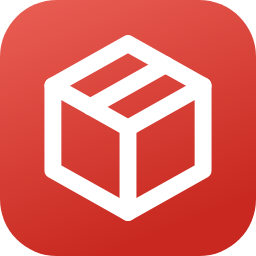
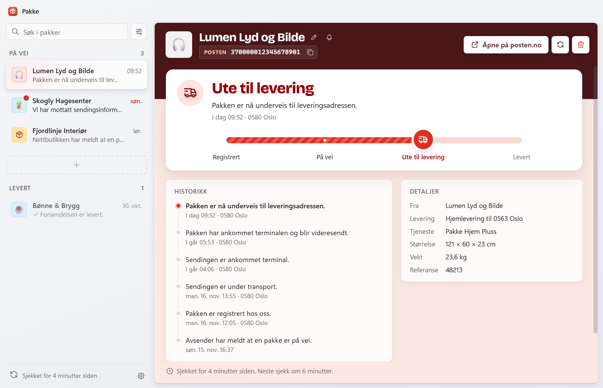
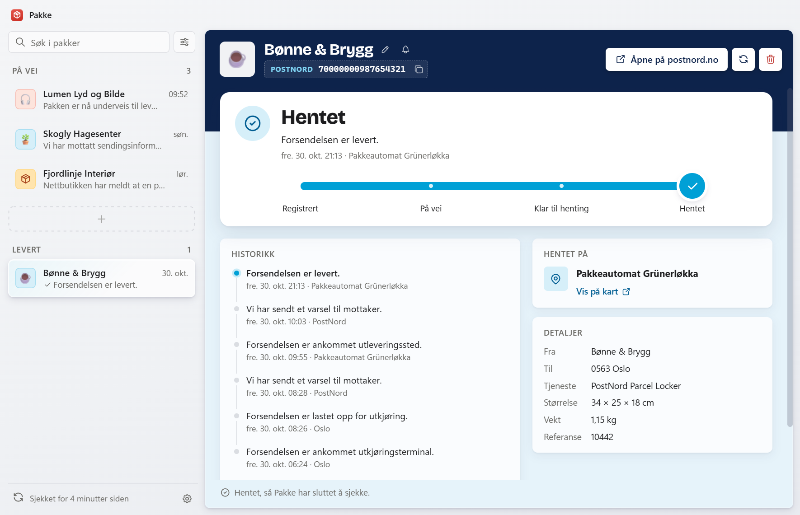
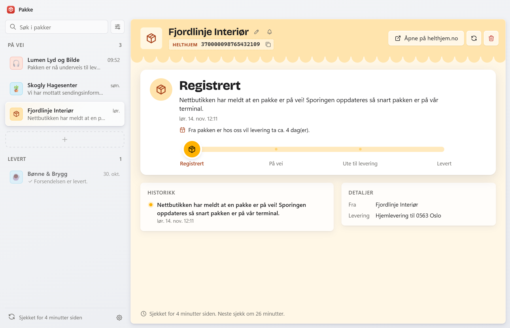
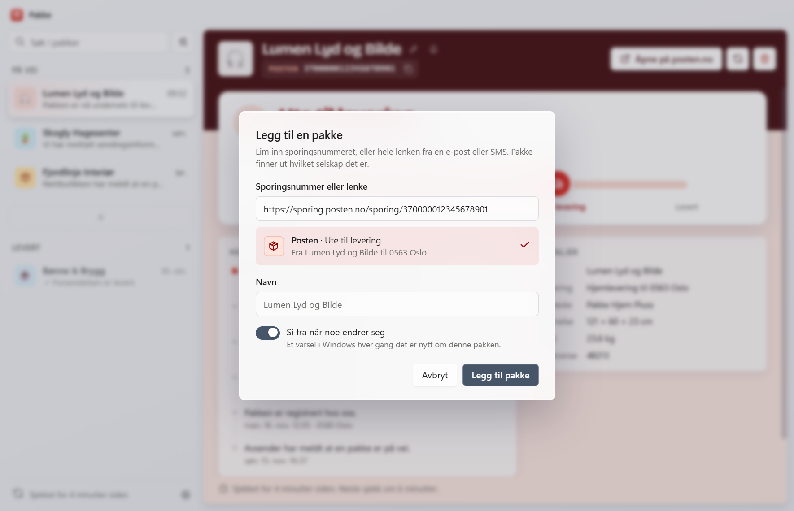
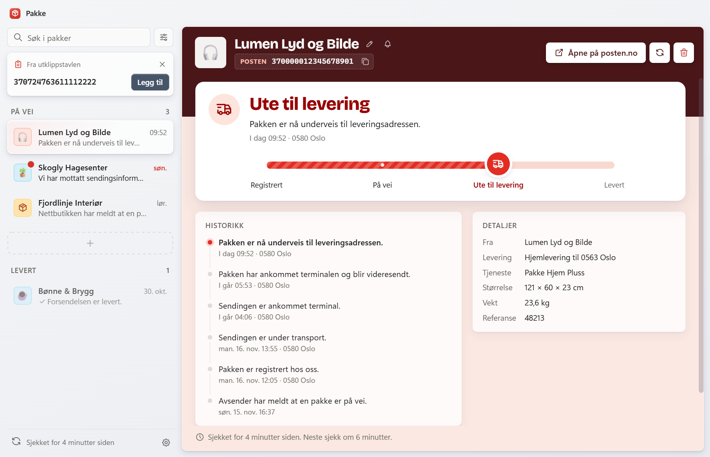
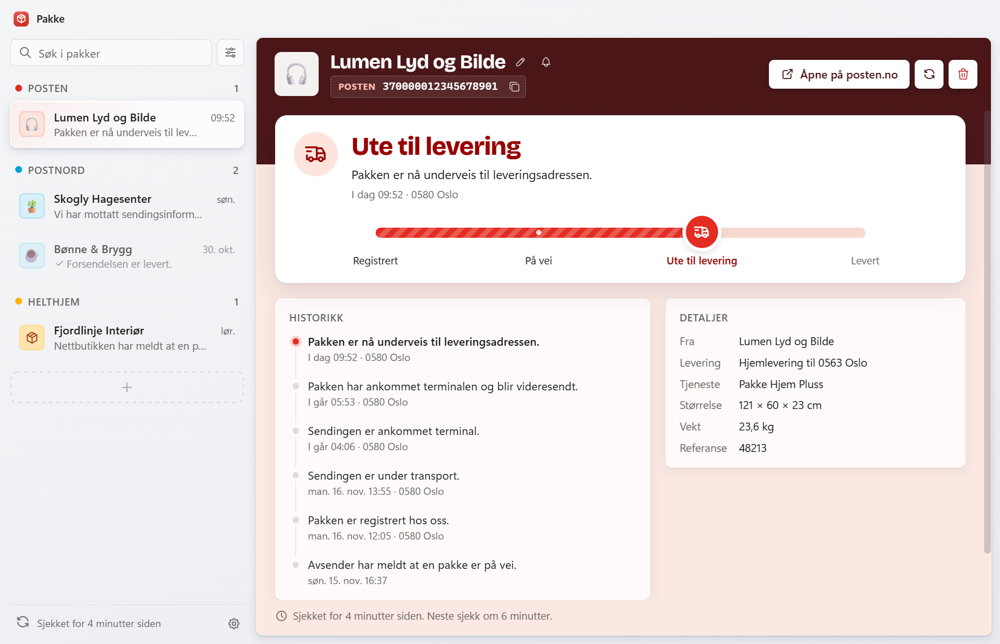
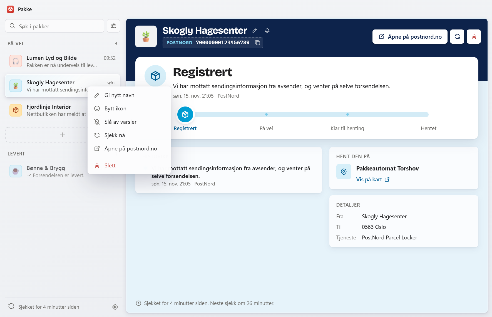
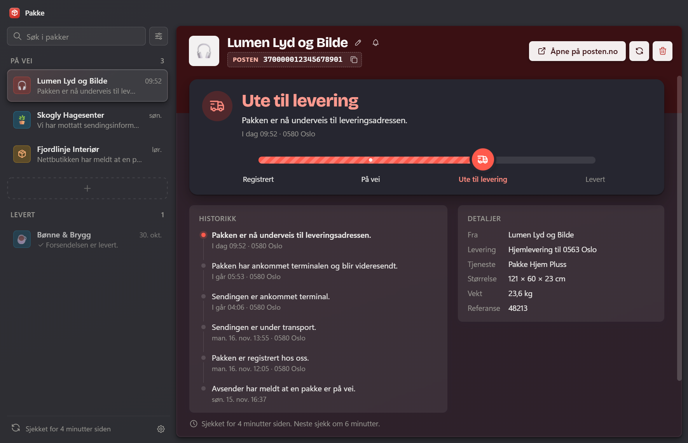
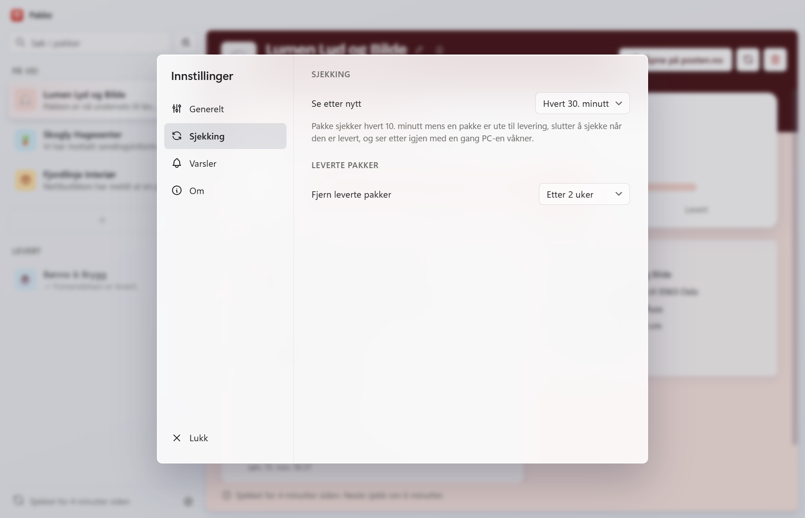

# Pakke

**Your parcels, without the refreshing.** Pakke (Norwegian for *parcel*) is a small Windows app that keeps an eye on your parcels from **Posten** (and Bring), **PostNord** and **Helthjem**, and tells you when something changes. It sits quietly in the tray, made to go with [Kalendar](https://github.com/ecnot/kalendar) and [Notat](https://github.com/ecnot/notat).

Paste a tracking number, and that's it. There's no account and no cloud: your parcels are kept on your PC.

*The screenshots use made-up shops, tracking numbers and addresses.*

## What it does

- **Paste and go.** Paste a tracking number, a link from an email, or a whole text message. Pakke finds the number and works out whether it's Posten, PostNord or Helthjem by itself. You can also just press Ctrl+V anywhere in the window, and if you've copied a tracking number, Pakke offers to add it when you open it.
- **Tells you when something changes.** A Windows notification for every change, or only the big steps (on the way, out for delivery, ready to pick up, delivered). News that comes at night waits until the morning, and you can turn notifications off for a single parcel.
- **Checks by itself.** Every 15 minutes, 30 minutes, hour, 2 hours or 4 hours, every 10 minutes while a parcel is out for delivery, and right after your PC wakes up. Delivered parcels aren't checked any more, and they're tidied away after a while.
- **In each carrier's own style.** Posten's maroon, PostNord's navy, Helthjem's yellow scallops, with a status card and a progress bar that shows where the parcel is now.
- **Everything the carrier knows.** The full history in the carrier's own words, the sender, the size and weight, the service, and where to pick it up.
- **Your own names and icons.** Every parcel is called after the shop that sent it, or whatever you like, with any emoji or one of almost 5,000 line icons.
- **Group and sort.** Group by on the way and delivered, or by company, and sort by the newest news or by name. Right-click a parcel to rename it, change its icon or delete it.
- **Light and dark,** with Windows 11's frosted glass and a transparency slider.
- **Norwegian (bokmål) and English.** Posten and PostNord are asked for their tracking in the same language. Helthjem only has Norwegian.

<table>
<tr>
<td></td>
<td></td>
</tr>
<tr>
<td align="center">PostNord, picked up from a parcel locker</td>
<td align="center">Helthjem, just registered</td>
</tr>
<tr>
<td></td>
<td></td>
</tr>
<tr>
<td align="center">Paste a number or a link</td>
<td align="center">Copied a tracking number? Pakke offers it</td>
</tr>
<tr>
<td></td>
<td></td>
</tr>
<tr>
<td align="center">Grouped by company</td>
<td align="center">Right-click to rename, change the icon or delete</td>
</tr>
<tr>
<td></td>
<td></td>
</tr>
<tr>
<td align="center">Dark mode</td>
<td align="center">Settings</td>
</tr>
</table>

## Keyboard

| Keys | What it does |
|---|---|
| Ctrl+V | Add whatever you copied |
| Ctrl+N | Add a parcel |
| Ctrl+F | Search |
| F5 | Check the parcel now |
| F2 | Rename |
| Delete | Delete (asks first) |
| ↑ ↓ | Next or previous parcel |

## Privacy

Your parcels are kept in `%APPDATA%\Pakke` on your PC. To follow them, Pakke asks the carriers' own tracking pages: sporing.posten.no for Posten, tracking.postnord.com for PostNord and helthjem.no for Helthjem, the same pages you'd open yourself. For PostNord and Helthjem it opens their page in a hidden window that keeps no cookies. The installed app also checks github.com/ecnot/pakke for new versions; you can turn that off in Settings. Nothing else leaves your PC, and Pakke never keeps the recipient's name a carrier may send.

Pakke reads the clipboard only when you press Ctrl+V in its window or bring the window to the front, never in the background.

Pakke isn't made by or connected to Posten, Bring, PostNord or Helthjem. If a carrier changes its tracking page, Pakke may need an update to read it again.

## Getting Pakke

Pakke is for Windows 10 and 11. Download the installer from the [Releases](https://github.com/ecnot/pakke/releases) page. Windows may show a SmartScreen warning because the installer isn't signed: choose *More info* and then *Run anyway*. Pakke updates itself after that. The frosted glass needs Windows 11 version 22H2 or newer; on older versions Pakke uses a solid background instead.

## Thanks

Icons from [Tabler Icons](https://tabler.io/icons) (MIT). Emoji names and keywords from [Emojibase](https://emojibase.dev) (MIT). The title font is [Bricolage Grotesque](https://github.com/ateliertriay/bricolage) (SIL Open Font License).
